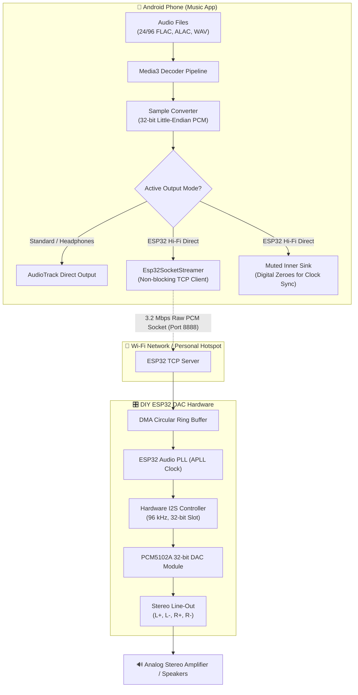

<div align="center">

# 🎵 Music: Bit-Perfect Audiophile Player & Wireless DAC

[](https://github.com/Gokul3611/HIFI_music_app/releases/download/latest/Music.apk)
[](https://github.com/Gokul3611/HIFI_music_app/releases/latest)
[](https://github.com/Gokul3611/HIFI_music_app/actions)
[](LICENSE)
[](CONTRIBUTING.md)

<br/>

**An open-source, bit-perfect 24-bit / 96 kHz music application for Android and ultra-low-latency ESP32 I2S hardware streaming.**  
*Zero advertisements. Zero sponsor tickers. Zero data telemetry. 100% free and open-source forever.*

---

[**Quick Install (.apk)**](#-quick-start--installation) • [**ESP32 Setup Guide**](ESP32_SETUP.md) • [**Architecture**](#-system-architecture) • [**Developer Guide**](#-developer--build-guide) • [**Contributing**](CONTRIBUTING.md)

</div>

---

## 📖 Project Overview

Most modern Android music players degrade high-resolution audio through the standard Android AudioFlinger / OpenSL ES / AAudio mixers, which force downsampling to 16-bit / 48 kHz. Furthermore, wireless Bluetooth streaming is severely constrained by standard lossy SBC/AAC codecs (~328 kbps).

**Music** solves both bottlenecks simultaneously:
1. **Bit-Perfect Android Engine:** Decodes studio-master FLAC, ALAC, WAV, and high-bitrate streams natively with zero Android audio downsampling.
2. **Wi-Fi Direct Hardware Streaming:** Transmits raw, uncompressed 24-bit / 96 kHz PCM frames (in 32-bit DMA slots) over a local Wi-Fi TCP socket (~3.2 Mbps throughput) directly to an **ESP32 microcontroller** driving a **PCM5102A 32-bit DAC breakout board**.
3. **Dedicated DIY Hardware Support:** Transform a ₹300 ($4) ESP32 + PCM5102A setup into an audiophile-grade wireless receiver for standalone analog stereo amplifiers (`L+`, `L-`, `R+`, `R-`).

---

## 🏛️ System Architecture



---

## 📊 Technical Specifications

| Parameter | Specification | Note |
| :--- | :--- | :--- |
| **Native Audio Resolution** | **24-bit / 96 kHz** (in 32-bit I2S slot) | Studio Master Bit-Perfect Quality |
| **Channel Configuration** | 2.0 Stereo (Left / Right) | Phase-aligned |
| **Wireless Transport** | 802.11n Wi-Fi TCP Socket (Port 8888) | Lossless, zero packet loss |
| **Bandwidth Requirement** | ~3.072 Mbps | Easily handled by Wi-Fi Direct / Hotspot |
| **I2S Master Clock** | Hardware APLL (<10 ps jitter) | Crystal-clean clock synchronization |
| **DAC Dynamic Range** | 112 dB (PCM5102A) | True hardware analog dynamic range |
| **Total Harmonic Distortion (THD+N)** | -93 dB | Audiophile line-out standard |
| **Android Version Support** | Android 8.0 (API 26) through Android 15 (API 35) | Full modern Jetpack Compose stack |

---

## 🚀 Quick Start & Installation

### For Android Users (Instant Install)
1. **Download the APK:** Tap [**Music.apk**](https://github.com/Gokul3611/HIFI_music_app/releases/download/latest/Music.apk) from the latest release.
2. **Install:** Open your browser's Downloads and tap `Music.apk`.
3. **Permissions:**
   - If Android prompts *"For security, your phone is not allowed to install unknown apps from this source"*, tap **Settings** $\to$ enable **Allow from this source**.
   - If Play Protect warns about an unverified developer, tap **More details** $\to$ **Install anyway** (standard for open-source self-compiled APKs).
4. **Launch:** Open **Music** from your launcher.

---

## 🎛️ ESP32 + PCM5102A Hardware Guide

You can build a wireless bit-perfect DAC receiver for **under ₹300 (~$3.60)** with zero soldering required.

### Hardware Parts List
1. **ESP32 Development Board** (ESP32-WROOM-32, 30-pin or 38-pin).
2. **PCM5102A 32-bit / 384 kHz I2S DAC Module** (purple or yellow PCB board).
3. **5× Female-to-Female Jumper Wires**.
4. **3.5mm Stereo AUX or RCA cable** to your amplifier.

### Wiring Diagram

| ESP32 Pin | PCM5102A Pin | Wire Function |
| :--- | :--- | :--- |
| **VIN / 5V** (or 3V3) | **VCC** | Power Supply |
| **GND** | **GND** | System Ground |
| **GPIO 26** | **BCK** | I2S Bit Clock (Continuous bit sync) |
| **GPIO 25** | **LCK / LRCK** | I2S Word Select (Left/Right Clock) |
| **GPIO 22** | **DIN / DATA** | I2S Serial Audio Data |
| **GND** | **SCK** | System Clock (Tied to GND for internal PLL mode) |

> [!NOTE]  
> On the back of the PCM5102A board, ensure solder jumpers are set to default (H1L/H2L/H3L/H4L): FLT (Low/Normal Latency), DMP (De-emphasis Off), SCL (Internal PLL), FMT (I2S Format).

### Flashing the ESP32 (Arduino IDE)
1. Open the [Arduino IDE](https://www.arduino.cc/en/software).
2. Go to **File $\to$ Open** and select [`firmware_wifi_softap/firmware_wifi_softap.ino`](firmware_wifi_softap/firmware_wifi_softap.ino).
3. Connect your ESP32 via micro-USB.
4. Select your board (**ESP32 Dev Module**) and Port.
5. Click **Upload**.
6. Turn on your phone's Personal Hotspot (**Hotspot Name:** `Stash-Hotspot`, **Password:** `12345678`).
7. In the **Music** app, navigate to **Settings $\to$ Audio & Quality $\to$ Output**, and select **ESP32 Hi-Fi Direct**. Your phone's speaker will mute and high-resolution sound will immediately stream through the DAC!

---

## 💻 Developer & Build Guide

The Android app is built using a modern multi-module architecture in Kotlin and C++ NDK.

### Prerequisites
- **JDK 17** (Temurin or Microsoft OpenJDK recommended)
- **Android Studio** Hedgehog (2023.1.1) or later
- **Android SDK 35** and **NDK 27.0.12077973**
- **CMake 3.22.1**

### Project Layout
```
HIFI_music_app/
├── app/                      # Application orchestrator, Hilt DI root, manifest
├── core/
│   ├── media/                # Audio engine (Media3, Esp32SocketStreamer, I2S DSP)
│   ├── ui/                   # Design system, Compose theme, SpaceGrotesk typography
│   ├── data/                 # DataStore preferences (HiResOutputPreference)
│   └── network/              # Low-overhead networking primitives
├── feature/
│   ├── home/                 # Main home screen, clean top bar, one-tap Offline/Online toggle
│   ├── settings/             # Settings hub, ESP32 hotspot dialog, audio quality picker
│   ├── nowplaying/           # Fullscreen player with real-time word-by-word synced lyrics
│   └── library/              # Local track browser and playlist management
└── firmware_wifi_softap/     # Ready-to-flash Arduino IDE sketch for ESP32 + PCM5102A
```

### Local Build Commands

```bash
# 1. Clone the repository
git clone https://github.com/Gokul3611/HIFI_music_app.git
cd HIFI_music_app

# 2. Build Debug APK
./gradlew assembleDebug

# 3. Install directly to a connected Android device via ADB
./gradlew installDebug

# 4. Run module unit test suite
./gradlew test
```

---

## 🤝 Contributing

Contributions from the community are warmly welcomed! Whether you want to improve UI aesthetics, optimize audio buffering, or add new hardware platform targets, here is how you can help:

### How to Contribute
1. **Fork the Repository:** Click the **Fork** button at the top right of this page.
2. **Create a Feature Branch:**
   ```bash
   git checkout -b feature/awesome-dsp-filter
   ```
3. **Commit Your Changes:**
   ```bash
   git commit -m "feat(dsp): implement parametric 10-band equalizer presets"
   ```
4. **Push to Your Fork:**
   ```bash
   git push origin feature/awesome-dsp-filter
   ```
5. **Open a Pull Request:** Submit a PR against `master` describing your changes and testing procedures.

### Priority Roadmap (Great Areas to Contribute)
- [ ] **mDNS / Zeroconf Auto-Discovery:** Automatically detect the ESP32 on the local subnet without requiring manual IP input.
- [ ] **Bluetooth LDAC / aptX-HD:** Add software encoder support for wireless Bluetooth headphones.
- [ ] **Desktop Streamer Client:** Companion app for Windows/macOS/Linux to stream system audio to the ESP32 DAC.
- [ ] **Parametric EQ Presets:** AutoEQ headphone profiles (Harman Target curve).

Please read our [**Contributing Guide**](CONTRIBUTING.md) for full coding conventions, branch standards, and architectural guidelines.

---

## 📜 License & Acknowledgements

- **License:** Distributed under the **GNU General Public License v3.0 (GPL-3.0)**. See [`LICENSE`](LICENSE) for terms.
- Built upon the foundational open-source architecture of the Stash project by Rawnald Clark.
- All trademarks and brand names belong to their respective owners.
